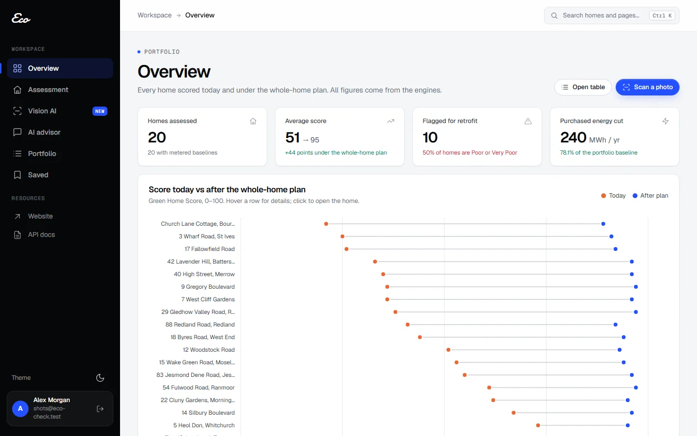

# Project Eco

**Know your home's green score. Get a retrofit plan you can trust.**

[](https://github.com/Julakanti-HariCharanReddy/Eco/actions/workflows/ci.yml)

Project Eco helps homeowners, advisors and lenders see how green a home is, what to fix first,
and what each upgrade will really save. It serves homes in the UK and India.

It started as our answer to Megathon X Problem Statement 2 (Lloyds Banking Group, team NSWN,
#310). We are now growing it into a full product.



## Try it

**Live website:** https://checked-ruby-several-sonic.trycloudflare.com/portal/

1. Create an account and add your home, or try the sample photo.
2. Open **Vision AI** and click **Live camera**: point your phone at a house and watch windows
   and doors being found in real time.
3. Pick upgrades or ask the advisor: "What if I add loft insulation and solar with a £15k budget?"

> The live link is hosted from a development machine while we set up permanent hosting, so it
> can be offline or change. To run your own copy, see [Run it locally](#run-it-locally).

---

## The problem

Homeowners and mortgage advisors can't easily answer three questions:

- **How green is this home?**
- **What should be fixed first?**
- **What will it save, and what could it add in value?**

Today's tools get three things wrong:

- **Order matters.** A heat pump in an uninsulated home runs at high flow temperatures, so it
  is less efficient and has to be oversized. Insulation has to come first.
- **Fuels shift.** A heat pump removes gas use and adds electricity use. A single combined
  kWh figure hides what actually changed.
- **Cost-based EPC ratings can mislead.** Electricity costs more per kWh than gas, so a
  low-carbon heat-pump switch can *lower* a home's EPC rating.

## What Project Eco does

| | |
|---|---|
| **Green Home Score** | A 0–100 score from 7 weighted parts, with a band and the main drivers |
| **Retrofit planner** | Puts upgrades in a valid order (insulation before heat pump), with cost and duration |
| **Energy and carbon** | Simulates gas and electricity separately, using UK carbon factors |
| **Building physics** | Hourly heat-loss model: heating need, heat-pump size and savings per measure |
| **Value estimate** | A gradient-boosted model gives an indicative property-value range |
| **Photo analysis** | Finds windows, doors, solar panels and heat leaks in home photos (YOLOv8, YOLO-World, SAM) |
| **Live camera** | Point a phone or webcam at a home: detections update over the video about once a second |
| **What-if advisor** | Ask in plain English, e.g. "loft insulation and solar with a £15k budget" |
| **Accounts** | Sign-in, your own homes and saved scenarios, admin view |

### The AI never calculates

Every number comes from a documented Python engine or a trained model. The language model
only does two things: it turns your question into a list of catalogue measures, and it
explains the results in words. Before any reply is shown, a validator checks that every
number in it appears in the computed results. A reply that fails this check is replaced by a
template.

## How it works

```
 Browser (web portal)
        │  HTTPS
        ▼
 Gateway (FastAPI): sign-in, your data, REST API /api/v1, database (PostgreSQL or SQLite)
        │
        ├── Score engine ─ Retrofit planner (dependency graph) ─ Carbon engine ─ Value model
        │
        ├── Vision service   YOLOv8 facade and solar models, YOLO-World, SAM outlines
        ├── Physics service  hourly 1R1C model, optional detailed EN ISO 52016 simulation
        └── LLM service      parses questions and words explanations (no maths)
```

The three services can run as separate containers (Docker Compose), or inside the gateway
for a simple local run.

**Built with:**
- **Web:** Python, FastAPI, Pydantic v2, SQLAlchemy, Alembic, NetworkX, scikit-learn, XGBoost.
- **Vision:** Ultralytics YOLO and Segment Anything.
- **Physics:** simple-simple / Home Energy Model weather data, with pyBuildingEnergy for the detailed simulation.
- **Front end and accounts:** a plain JavaScript front end, with Supabase or built-in sign-in.

## Roadmap

We research the problem every day and update the product as we learn. Next up:

- [ ] **YOLO26 detectors:** train YOLO26 on window, door and solar datasets. We switch only when it beats
      the current YOLOv8 models on the same test photos (YOLO26 out of the box missed most windows).
- [ ] **Permanent hosting** with a fixed domain, replacing the temporary demo link.
- [ ] **Real EPC data:** pull certificates by address from the UK EPC register.
- [ ] **India support:** local tariffs, grid carbon factors and building types.
- [ ] **Lender view:** portfolio dashboards for green-mortgage teams.
- [ ] **Installer quotes:** turn the plan into a shareable quote request.

Ideas, bugs and data sources are welcome as GitHub issues.

## Run it locally

You need Python 3.12 or newer.

```bash
cd eco-engine
pip install -r requirements.txt
cp .env.example .env          # optional: add Supabase or Claude API settings
python -m uvicorn backend.main:app --port 8000
```

Open http://localhost:8000/portal/, create an account and add a home.

- **Without the model weights,** photo analysis falls back to basic image checks. Weights are
  not stored in git because they are too large. Where to get each one is listed in
  [eco-engine/README.md](eco-engine/README.md#third-party-models-computer-vision--epc-second-opinion).
- **Without an AI API key,** the advisor gives template explanations. All numbers are identical.
- **Full stack with Docker:** `docker compose up --build -d` inside `eco-engine/`. You need
  `POSTGRES_PASSWORD`, `ECO_AUTH_SECRET` and `ECO_SERVICE_TOKEN` in `.env`.

## Tests

```bash
cd eco-engine
python -m pytest tests -p no:anyio -q
```

The 128 tests cover:
- score rules,
- upgrade ordering,
- carbon factors,
- building physics,
- the AI number check,
- per-user data isolation,
- security headers and rate limits,
- the service contracts.

GitHub Actions runs them on every push, and also reports each CI run's energy and carbon cost
using Eco CI.

## Repository layout

```
eco-engine/
  backend/      gateway: API routes, engines, database, auth, security
  services/     vision, LLM and physics microservices
  frontend/web/ web portal (landing page, app, sign-in)
  migrations/   Alembic database migrations
  data/         sample homes and weather file
  tests/        test suite
docs/           approach document (M1)
M1-5.pdf, M2 (1).pdf   Megathon X submissions (where it started)
```

Full technical documentation: [eco-engine/README.md](eco-engine/README.md)
